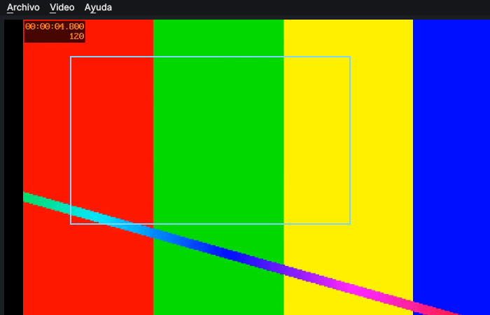
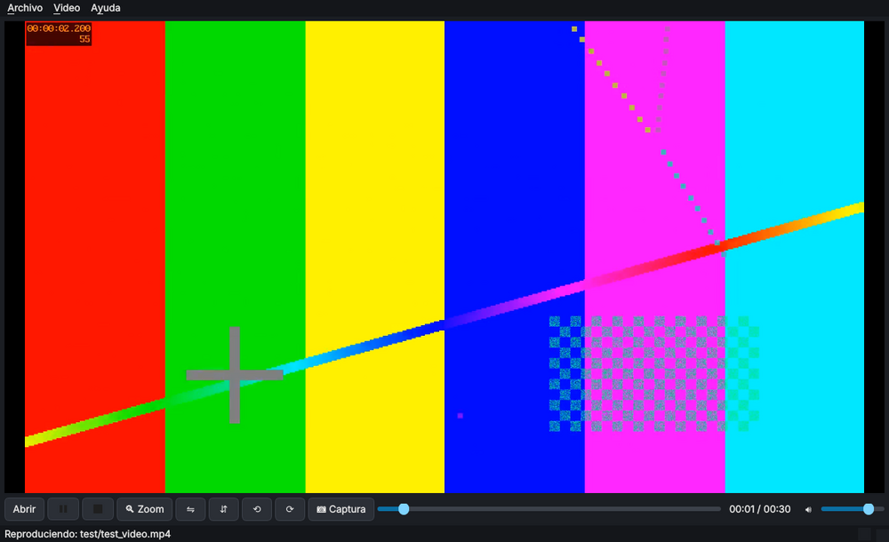
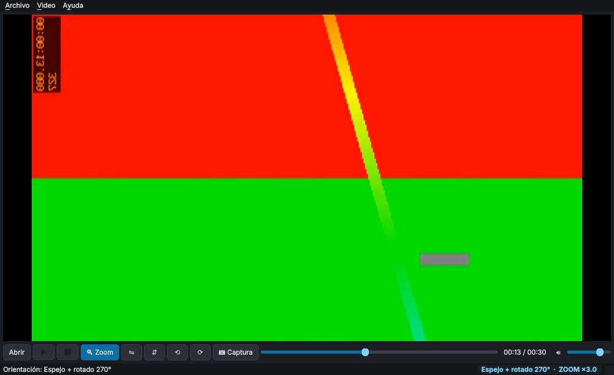
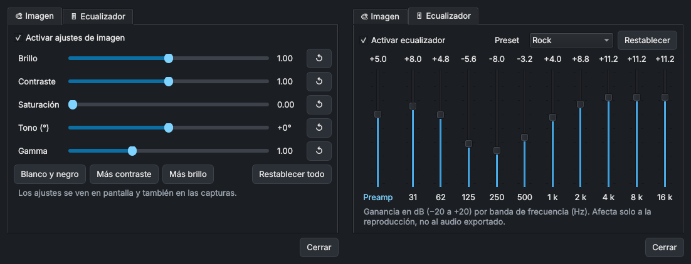
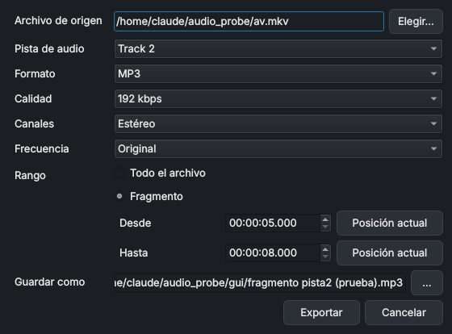

# VLC Zoom Player

Reproductor de video para escritorio basado en **libVLC** (el motor de VLC) con funciones pensadas para analizar imágenes en movimiento:

- **Zoom por recuadro**: dibujas con el mouse un recuadro sobre el video y esa zona pasa a ocupar todo el reproductor, en vivo. Se puede ampliar de nuevo dentro de una zona ya ampliada (zoom anidado) y volver nivel por nivel.
- **Espejo** horizontal y vertical.
- **Rotación** de 90° en ambos sentidos. Se combina con el espejo y con el zoom: la zona ampliada se conserva al girar.
- **Captura de lo que se ve**: guarda un PNG con el zoom, el espejo y la rotación aplicados, a la resolución real de esa zona del video (no es un pantallazo).
- **Ajustes de imagen** en vivo: brillo, contraste, saturación, tono y gamma, con atajos como "Blanco y negro". Los ajustes también salen en las capturas.
- **Ecualizador de audio** de 10 bandas (31 Hz a 16 kHz) con preamplificador y 18 presets (Rock, Pop, Clásica, Graves…).
- **Exportar audio** de cualquier archivo que VLC pueda abrir (video o audio) a MP3, AAC (M4A), Ogg Vorbis, Opus, WAV o FLAC. Se puede exportar el archivo completo o un fragmento, elegir la pista de audio, la calidad y mono o estéreo, todo sin detener la reproducción.
- Reproduce todo lo que reproduce VLC. Se pueden arrastrar archivos a la ventana y abrirlos con "Abrir con…" desde el Explorador.



| Original | Espejo + rotación + zoom |
|---|---|
|  |  |

## Requisitos

- **VLC media player 3.x** instalado, de la **misma arquitectura que Python**. Con Python de 64 bits se necesita VLC de 64 bits.
- **Python 3.10 o superior** (las pruebas automáticas usan 3.11, 3.12 y 3.13).
- Windows 10/11 (plataforma principal) o Linux. En macOS debería funcionar, pero no está probado.

## Instalación

### Windows

1. Instala VLC desde <https://www.videolan.org/>.
2. Instala Python desde <https://www.python.org/> y marca "Add python.exe to PATH".
3. Descarga o clona este repositorio y ejecuta **`instalar.bat`**. Crea `.venv` e instala las dependencias.
4. Abre la app con **`ejecutar.bat`**. También puedes arrastrar un video sobre `ejecutar.bat` o usarlo en "Abrir con…".

Si VLC está instalado en una carpeta no estándar, define la variable de entorno `VLC_DIR` con esa ruta.

### Linux

```bash
sudo apt install vlc            # o el equivalente de tu distribución
python3 -m venv .venv
.venv/bin/pip install -r requirements.txt
.venv/bin/python -m vlc_zoom_player [video.mp4]
```

### Ejecutable de Windows (sin instalar Python)

Cada vez que se sube código a `main`, GitHub Actions (`.github/workflows/ci.yml`) corre las pruebas y genera **VLCZoomPlayer-windows.zip**. Se descarga desde la pestaña **Actions**: abre la ejecución más reciente y busca la sección *Artifacts*. Si publicas una etiqueta `v0.3.0` (o cualquier `v*`), el zip queda además adjunto a un *Release*. El ejecutable usa el VLC de 64 bits instalado en el equipo.

## Uso

| Tecla | Acción |
|---|---|
| `z` | Zoom: dibujar recuadro (o quitar el zoom si ya está activo) |
| `Shift+Z` | Volver al nivel de zoom anterior |
| `s` | Captura de lo que se ve (PNG) |
| `h` / `v` | Espejo horizontal / vertical |
| `r` / `Shift+R` | Rotar 90° horario / antihorario |
| `Ctrl+0` | Restablecer orientación |
| `Espacio` | Play / Pausa |
| `←` / `→` | Retroceder / avanzar 5 s |
| `f` o doble clic | Pantalla completa |
| `Esc` / clic derecho | Cancelar selección · salir de pantalla completa |
| `Ctrl+O` | Abrir archivo |
| `Ctrl+E` | Exportar audio |
| `Ctrl+I` | Ajustes de imagen |
| `Ctrl+Shift+E` | Ecualizador |

Las capturas se guardan por defecto en `Imágenes/VLC Zoom Player`. La carpeta se cambia en **Archivo → Elegir carpeta de capturas…**. El nombre incluye el video, el minuto del video y la fecha con milisegundos, así que dos capturas seguidas no se sobrescriben.

### Ajustes de imagen y ecualizador

Botón **🎛 Ajustes**, **Video → Ajustes de imagen…** (`Ctrl+I`) o **Audio → Ecualizador…** (`Ctrl+Shift+E`). La ventana no bloquea el reproductor: los cambios se ven y se oyen al instante, también con el video en pausa, y se recuerdan para la próxima vez.

- **Imagen:** brillo (0–2), contraste (0–2), saturación (0–3), tono (−180° a +180°) y gamma (0,1–3). Cada control tiene un botón para volver a su valor original, y hay atajos de "Blanco y negro", "Más contraste" y "Más brillo". Los ajustes se mantienen al girar o reflejar el video.
- **Ecualizador:** 10 bandas de −20 a +20 dB, preamplificador y presets de VLC. Al mover una banda el preset pasa a "Personalizado".



### Exportar audio

Botón **🎵 Audio**, **Archivo → Exportar audio…** o `Ctrl+E`. El origen es por defecto el archivo que se está reproduciendo, aunque se puede elegir cualquier otro. Opciones:

| Opción | Valores |
|---|---|
| Formato | MP3, AAC (.m4a), Ogg Vorbis, Opus, WAV, FLAC (en contenedor Ogg, .oga) |
| Calidad | 64 a 320 kbps según el formato (WAV y FLAC son sin pérdida) |
| Canales | Estéreo o mono |
| Frecuencia | Original, 44 100 Hz o 48 000 Hz (Opus siempre usa 48 000 Hz) |
| Pista | Cualquiera de las pistas de audio del archivo (por ejemplo, idiomas) |
| Rango | Todo el archivo o un fragmento; el botón "Posición actual" toma el instante del video |



La exportación usa el transcodificador de VLC: no requiere ffmpeg ni otras instalaciones. Un archivo de una hora tarda pocos segundos y la ventana muestra el progreso, con opción de cancelar.

## Cómo funciona (notas técnicas)

El video se dibuja en la ventana nativa de VLC, que mantiene la aceleración por hardware. Para eso hubo que sortear varias particularidades de libVLC 3:

- **Recorte (zoom).** La sintaxis `AxH+X+Y` de `libvlc_video_set_crop_geometry` ubica mal la región en VLC 3.0. Se usa la sintaxis de márgenes `izq+arr+der+aba`, que sí es exacta. Con espejo o rotación activos, VLC interpreta el recorte en un espacio con las medidas del video original, proyectado proporcionalmente sobre la imagen ya transformada. `geometry.py` hace esa conversión.
- **Espejo y rotación.** El filtro `transform` de VLC solo se aplica como opción de *instancia*: si se pasa como opción del medio, se ignora. Por eso, al cambiar la orientación se recrea el reproductor y se vuelve al mismo instante, con el mismo volumen, estado de pausa y zoom. Se nota un corte breve. Las 8 combinaciones de espejo y giro se modelan como el grupo diédrico D4 y cada una corresponde a un valor de `--transform-type`.
- **Captura.** `libvlc_video_take_snapshot` captura la imagen ya recortada y transformada, pero hay que pasarle el ancho y el alto reales de la zona visible. Si se le pasa `0×0` usa las medidas del video original y la imagen sale deformada. También se desactiva `snapshot-preview`, que dibuja una miniatura en la esquina del video.
- **Selección con el mouse.** La ventana nativa de VLC tapa a los widgets de Qt. El marco del recuadro es una ventana flotante con máscara de contorno, que se ve igual con o sin compositor. Además se desactiva la captura de mouse y teclado de VLC (`video_set_mouse_input(False)`) para que los eventos lleguen a Qt.

- **Exportar audio.** Se crea una instancia de libVLC aparte con una cadena `#transcode{vcodec=none,…}:std{…}`. Se añade `:no-sout-all` porque, sin esa opción, VLC mezcla todas las pistas de audio en el mismo archivo. Con algunos contenedores (MKV) VLC ignora `:start-time` al transcodificar. Por eso, si el fragmento no empieza en 0, se exporta primero a un WAV temporal hasta el final del fragmento, se recorta el inicio y luego se codifica al formato elegido. FLAC va en Ogg porque el FLAC "crudo" de VLC queda sin duración en la cabecera.

- **Ajustes de imagen.** Usan el filtro `adjust` de VLC (`video_set_adjust_*`), que actúa antes de la captura. Al recrear el reproductor VLC ignora "activar" si cree que el filtro ya estaba activo, así que en ese momento la app lo apaga y lo vuelve a encender. Volver a buscar la misma posición para refrescar un video pausado no sirve: recrea la salida de video y se pierde el filtro.
- **Ecualizador.** Usa `libvlc_audio_equalizer_*` sobre el reproductor. El transcodificador de VLC ignora el filtro de ecualizador, por eso no se aplica al exportar audio.

```
vlc_zoom_player/
  app.py          ventana principal, reproductor y acciones
  effects.py      estado y aplicación de ajustes de imagen y ecualizador
  effects_dialog.py ventana "Ajustes" (pestañas Imagen y Ecualizador)
  audio_export.py exportación de audio con el transcodificador de libVLC
  export_dialog.py  diálogo "Exportar audio"
  geometry.py     matemática pura de zoom, espejo y rotación (sin Qt ni VLC)
  vlc_loader.py   localiza libVLC en Windows y muestra un error claro si falta
tests/            pruebas unitarias (geometría, exportación de audio, efectos)
tools/smoke_test.py   prueba de extremo a extremo con la app real
```

## Pruebas

```bash
pip install -r requirements-dev.txt
python -m pytest                                    # geometría
python tools/smoke_test.py video.mp4 salida_prueba  # app real: zoom, giro, espejo, capturas
```

La prueba de humo reproduce el video, aplica zoom (incluido el anidado), rotación y espejo con el video en pausa. En cada paso guarda capturas y pantallazos y comprueba que cada captura tenga exactamente las dimensiones de la zona visible.

## Limitaciones conocidas

- Cambiar el espejo o la rotación produce un corte breve, porque se recrea el reproductor. Es una limitación de libVLC 3.
- Con espejo o rotación, VLC puede dejar de usar la decodificación por hardware para aplicar el filtro. En videos 4K eso puede subir el uso de CPU.
- El ecualizador afecta a la reproducción, no al audio exportado.
- No se tiene en cuenta la relación de aspecto de píxel no cuadrado (video anamórfico) al calcular el recuadro.

## Licencia

GPL-3.0-or-later (ver [LICENSE](LICENSE)). Usa PyQt5 (GPL v3) y python-vlc / libVLC (LGPL 2.1+).
