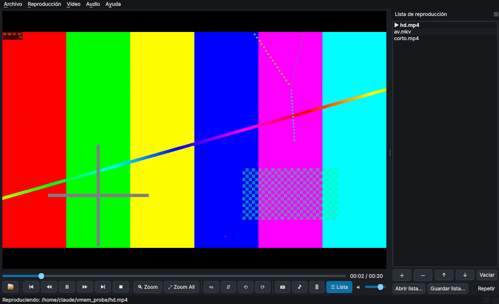
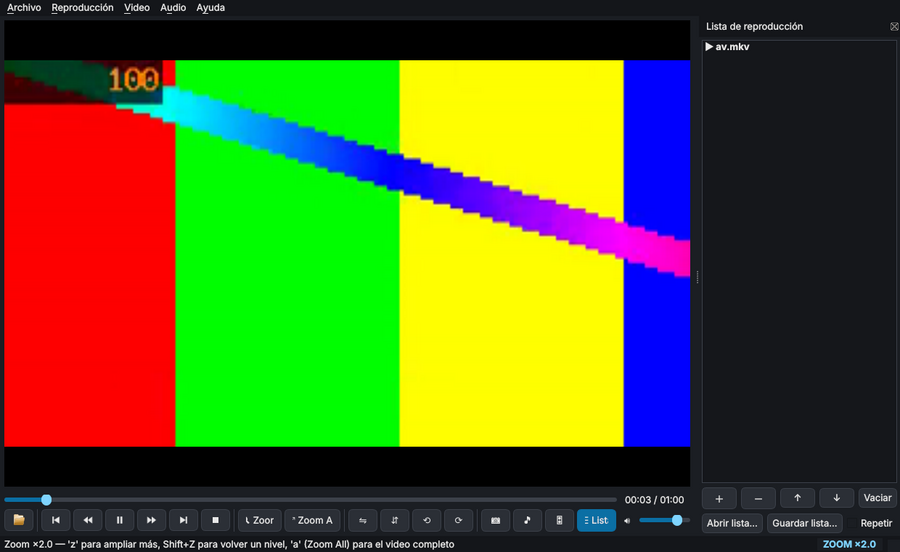

# VLC Zoom Player

Reproductor de video para escritorio basado en **libVLC** (el motor de VLC) con funciones pensadas para analizar imágenes en movimiento:

- **Zoom por recuadro (zoom window)**: dibujas con el mouse un recuadro sobre el video y esa zona pasa a ocupar todo el reproductor, en vivo. El recuadro mantiene la proporción del video y la imagen nunca se deforma. Se puede ampliar dentro de una zona ya ampliada (zoom anidado), volver un nivel o pulsar **Zoom All** para ver el video completo.
- **Espejo** horizontal y vertical, y **rotación** de 90° en ambos sentidos. Son instantáneos y se combinan con el zoom.
- **Captura de lo que se ve**: guarda un PNG con el zoom, el espejo, la rotación y los ajustes de imagen, a la resolución real de esa zona del video (no es un pantallazo).
- **Lista de reproducción**: panel lateral para agregar, quitar y reordenar archivos, pasar al siguiente automáticamente, repetir la lista y guardar o abrir listas `.m3u`.
- **Controles de reproducción**: anterior y siguiente de la lista, atrasar y adelantar 10 s, play/pausa y detener.
- **Ajustes de imagen** en vivo: brillo, contraste, saturación, tono y gamma.
- **Ecualizador de audio** de 10 bandas (31 Hz a 16 kHz) con preamplificador y 18 presets.
- **Exportar audio** de cualquier archivo que VLC pueda abrir a MP3, AAC (M4A), Ogg Vorbis, Opus, WAV o FLAC, completo o por fragmento.
- Reproduce todo lo que reproduce VLC. Se pueden arrastrar archivos a la ventana y abrirlos con "Abrir con…" desde el Explorador.



| Selección del recuadro | Resultado del zoom |
|---|---|
|  |  |

## Requisitos

- **VLC media player 3.x** instalado, de la **misma arquitectura que Python**. Con Python de 64 bits se necesita VLC de 64 bits.
- **Python 3.10 o superior** (las pruebas automáticas usan 3.11, 3.12 y 3.13).
- Windows 10/11 (plataforma principal) o Linux. En macOS debería funcionar, pero no está probado.

## Instalación

### Windows

1. Instala VLC desde <https://www.videolan.org/>.
2. Instala Python desde <https://www.python.org/> y marca "Add python.exe to PATH".
3. Descarga o clona este repositorio y ejecuta **`instalar.bat`**. Crea `.venv` e instala las dependencias.
4. Abre la app con **`ejecutar.bat`**. También puedes arrastrar videos sobre `ejecutar.bat` o usarlo en "Abrir con…".

Si VLC está instalado en una carpeta no estándar, define la variable de entorno `VLC_DIR` con esa ruta.

### Linux

```bash
sudo apt install vlc            # o el equivalente de tu distribución
python3 -m venv .venv
.venv/bin/pip install -r requirements.txt
.venv/bin/python -m vlc_zoom_player [video.mp4 ...]
```

### Ejecutable de Windows (sin instalar Python)

GitHub Actions (`.github/workflows/ci.yml`) **no se ejecuta automáticamente**. Para lanzarlo: pestaña **Actions → CI → Run workflow**. Corre las pruebas y, si dejas marcada la opción "Generar el ejecutable de Windows", crea **VLCZoomPlayer-windows.zip**. Se descarga desde esa misma ejecución, en la sección *Artifacts*. Si escribes una versión (por ejemplo `v0.5.0`), el zip se publica además como *Release*. El ejecutable usa el VLC de 64 bits instalado en el equipo.

## Uso

Los botones de la barra inferior, de izquierda a derecha: abrir · anterior, atrasar 10 s, play/pausa, adelantar 10 s, siguiente, detener · **Zoom**, **Zoom All** · espejo horizontal, espejo vertical, rotar ⟲, rotar ⟳ · captura 📷, exportar audio 🎵, ajustes 🎛, **☰ Lista** · volumen.

| Tecla | Acción |
|---|---|
| `z` | Zoom: dibujar recuadro |
| `a` | Zoom All: volver al video completo |
| `Shift+Z` | Volver al nivel de zoom anterior |
| `s` | Captura de lo que se ve (PNG) |
| `h` / `v` | Espejo horizontal / vertical |
| `r` / `Shift+R` | Rotar 90° horario / antihorario |
| `Ctrl+0` | Restablecer orientación |
| `Espacio` | Play / Pausa |
| `←` / `→` | Retroceder / avanzar 5 s |
| `Shift+←` / `Shift+→` | Retroceder / avanzar 10 s |
| `p` / `n` | Anterior / siguiente de la lista |
| `Ctrl+L` | Mostrar / ocultar la lista de reproducción |
| `f` o doble clic | Pantalla completa |
| `Esc` / clic derecho | Cancelar selección · salir de pantalla completa |
| `Ctrl+O` | Abrir archivos (se agregan a la lista) |
| `Ctrl+E` | Exportar audio |
| `Ctrl+I` | Ajustes de imagen |
| `Ctrl+Shift+E` | Ecualizador |

Las capturas se guardan por defecto en `Imágenes/VLC Zoom Player`. La carpeta se cambia en **Archivo → Elegir carpeta de capturas…**. El nombre incluye el video, el minuto del video y la fecha con milisegundos, así que dos capturas seguidas no se sobrescriben.

### Zoom por recuadro

Pulsa **🔍 Zoom** (o `z`) y arrastra sobre el video. El recuadro conserva la proporción de la imagen, así que la zona elegida llena el reproductor sin franjas ni deformación. Puedes repetir el zoom sobre la zona ampliada. **Zoom All** (o `a`) vuelve al video completo, y `Shift+Z` retrocede un nivel. Al cambiar de archivo el zoom se reinicia.

### Lista de reproducción

Botón **☰ Lista** (`Ctrl+L`). Abrir archivos o arrastrarlos a la ventana los agrega a la lista y reproduce el primero. En el panel:

- doble clic para reproducir; arrastrar o usar ↑ ↓ para reordenar; `Supr` o − para quitar;
- **Repetir**: al terminar el último vuelve al primero;
- **Abrir lista… / Guardar lista…** en formato `.m3u`.

Al terminar un archivo pasa solo al siguiente. La lista se recuerda al cerrar la app.

### Ajustes de imagen y ecualizador

Botón **🎛**, **Video → Ajustes de imagen…** (`Ctrl+I`) o **Audio → Ecualizador…** (`Ctrl+Shift+E`). La ventana no bloquea el reproductor: los cambios se ven y se oyen al instante y se recuerdan para la próxima vez.

- **Imagen:** brillo (0–2), contraste (0–2), saturación (0–3), tono (−180° a +180°) y gamma (0,1–3). Cada control tiene un botón para volver a su valor original, y hay atajos de "Blanco y negro", "Más contraste" y "Más brillo".
- **Ecualizador:** 10 bandas de −20 a +20 dB, preamplificador y presets de VLC. Al mover una banda el preset pasa a "Personalizado".


### Exportar audio

Botón **🎵**, **Archivo → Exportar audio…** o `Ctrl+E`. El origen es por defecto el archivo que se está reproduciendo, aunque se puede elegir cualquier otro.

| Opción | Valores |
|---|---|
| Formato | MP3, AAC (.m4a), Ogg Vorbis, Opus, WAV, FLAC (en contenedor Ogg, .oga) |
| Calidad | 64 a 320 kbps según el formato (WAV y FLAC son sin pérdida) |
| Canales | Estéreo o mono |
| Frecuencia | Original, 44 100 Hz o 48 000 Hz (Opus siempre usa 48 000 Hz) |
| Pista | Cualquiera de las pistas de audio del archivo (por ejemplo, idiomas) |
| Rango | Todo el archivo o un fragmento; el botón "Posición actual" toma el instante del video |


La exportación usa el transcodificador de VLC: no requiere ffmpeg. Un archivo de una hora tarda pocos segundos y la ventana muestra el progreso, con opción de cancelar.

## Cómo funciona (notas técnicas)

- **Dibujo del video.** VLC decodifica el audio y el video y entrega cada fotograma en memoria (callbacks `vmem`, formato RV32). La app lo dibuja con Qt (`video_view.py`). Así el zoom, el espejo y la rotación son transformaciones al dibujar: no dependen de la salida de video de VLC, cuyo recorte (`crop_geometry`) fallaba según el sistema (en Windows con Direct3D dejaba la pantalla en negro), y funcionan igual en Windows y Linux. Un video 1080p usa alrededor de un tercio de un núcleo de CPU. Los videos de más de 4K se reducen a 3840 px de ancho.
- **Proporción.** La zona visible se encaja siempre con la misma escala horizontal y vertical, con franjas negras si hace falta, y el recuadro de selección se ajusta a la proporción de la imagen. Las 8 combinaciones de espejo y giro se modelan como el grupo diédrico D4 (`geometry.py`).
- **Formato de los fotogramas.** python-vlc declara el parámetro de formato como una copia (`c_char_p`), y así no se puede pedir RV32. Por eso la app define su propio prototipo de `libvlc_video_set_format_callbacks`. VLC agrega filas de relleno abajo; se dibuja solo el tamaño visible (`video_get_size`).
- **Captura.** Se genera con los mismos píxeles y la misma transformación que se ven en pantalla, a la resolución real de la zona visible.
- **Ajustes de imagen.** Usan el filtro `adjust` de VLC (`video_set_adjust_*`), que actúa antes de entregar el fotograma, así que se ven y se capturan. Cuando VLC crea una salida de video nueva ignora "activar" si cree que el filtro ya estaba activo; en ese momento la app lo apaga y lo vuelve a encender.
- **Ecualizador.** Usa `libvlc_audio_equalizer_*`. El transcodificador de VLC ignora el filtro de ecualizador, por eso no se aplica al exportar audio.
- **Exportar audio.** Instancia de libVLC aparte con `#transcode{vcodec=none,…}:std{…}` y `:no-sout-all`, porque sin esa opción VLC mezcla todas las pistas de audio en el mismo archivo. Con algunos contenedores (MKV) VLC ignora `:start-time` al transcodificar. Por eso, si el fragmento no empieza en 0, se exporta a un WAV temporal, se recorta el inicio y luego se codifica al formato elegido.

```
vlc_zoom_player/
  app.py            ventana principal, controles y acciones
  video_view.py     recepción de fotogramas de libVLC y dibujo con zoom/espejo/rotación
  playlist.py       panel de lista de reproducción (.m3u)
  geometry.py       matemática pura de zoom, espejo y rotación
  effects.py        estado y aplicación de ajustes de imagen y ecualizador
  effects_dialog.py ventana "Ajustes" (pestañas Imagen y Ecualizador)
  audio_export.py   exportación de audio con el transcodificador de libVLC
  export_dialog.py  diálogo "Exportar audio"
  vlc_loader.py     localiza libVLC en Windows y muestra un error claro si falta
tests/              pruebas unitarias
tools/smoke_test.py prueba de extremo a extremo con la app real
```

## Pruebas

```bash
pip install -r requirements-dev.txt
python -m pytest                                              # pruebas unitarias
python tools/smoke_test.py video.mp4 video_corto.mp4 salida   # app real
```

La prueba de extremo a extremo reproduce los videos y prueba la selección con el mouse (proporción del recuadro), el zoom anidado, Zoom All, adelantar y atrasar, la rotación y el espejo en pausa, los ajustes de imagen en las capturas, el ecualizador y el paso automático al siguiente de la lista. También comprueba que la imagen en pantalla nunca se deforme.

## Limitaciones conocidas

- El ecualizador afecta a la reproducción, no al audio exportado.
- No se tiene en cuenta la relación de aspecto de píxel no cuadrado (video anamórfico).
- Cada fotograma pasa por la memoria para dibujarlo. En videos 4K el uso de CPU es mayor que en VLC.

## Licencia

GPL-3.0-or-later (ver [LICENSE](LICENSE)). Usa PyQt5 (GPL v3) y python-vlc / libVLC (LGPL 2.1+).
